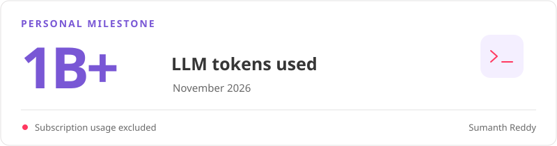

# Hey, I'm Sumanth.

### `> whoami`

```python
sumanth = {
    "motto": "Ship it. Open-source it. Move on.",
    "team": "All employees are AI.",
    "focus": "AI agents that actually do things",
    "off_screen": ["anime", "manga"],
}
```

<picture>
  <source media="(prefers-color-scheme: dark)" srcset="./milestone-dark.svg" />
  
</picture>

### On my desk

- **[SimReady](https://github.com/Sumanthreddy-DE/simready)** · CAD checks before simulation.
- **[resume-assistant](https://github.com/Sumanthreddy-DE/resume-assistant)** · A chatbot for my CV, with evals.
- **[self-talk-coach](https://github.com/Sumanthreddy-DE/self-talk-coach)** · Spoken German practice from the terminal.

## Tech Stack

<p align="center">
  
  
  
  
  <br />
  
  
  
  
</p>

## GitHub stats

<picture>
  <source media="(prefers-color-scheme: dark)" srcset="https://github-readme-stats-omega-lemon.vercel.app/api?username=Sumanthreddy-DE&amp;theme=buefy&amp;hide_border=false&amp;hide_title=true&amp;disable_animations=true&amp;title_color=b69af7&amp;text_color=e6edf3&amp;bg_color=0d1117&amp;icon_color=ff6b8a&amp;border_color=30363d&amp;show_icons=true&amp;rank_icon=github" />
  
</picture>
<picture>
  <source media="(prefers-color-scheme: dark)" srcset="https://github-profile-summary-cards.vercel.app/api/cards/most-commit-language?username=Sumanthreddy-DE&amp;theme=default&amp;title_color=b69af7&amp;text_color=e6edf3&amp;bg_color=0d1117&amp;icon_color=ff6b8a&amp;border_color=30363d&amp;chart_color=b69af7" />
  
</picture>

<p align="center">
  <picture>
    <source media="(prefers-color-scheme: dark)" srcset="https://streak-stats.demolab.com/?user=Sumanthreddy-DE&amp;background=0d1117&amp;border=30363d&amp;stroke=30363d&amp;ring=b69af7&amp;fire=ff6b8a&amp;currStreakNum=e6edf3&amp;sideNums=e6edf3&amp;currStreakLabel=b69af7&amp;sideLabels=b69af7&amp;dates=9da7b3&amp;hide_border=false&amp;disable_animations=true" />
    
  </picture>
</p>

## Connect with me

<p>
  <a href="https://www.linkedin.com/in/sumanthreddys"></a>
  <a href="https://sumanthreddy.de"></a>
  <a href="mailto:sumanthreddy.settipalli@gmail.com"></a>
</p>
